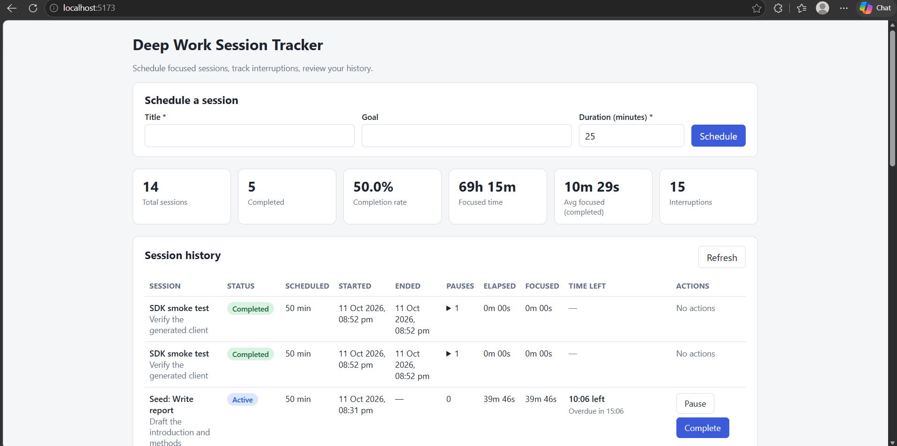
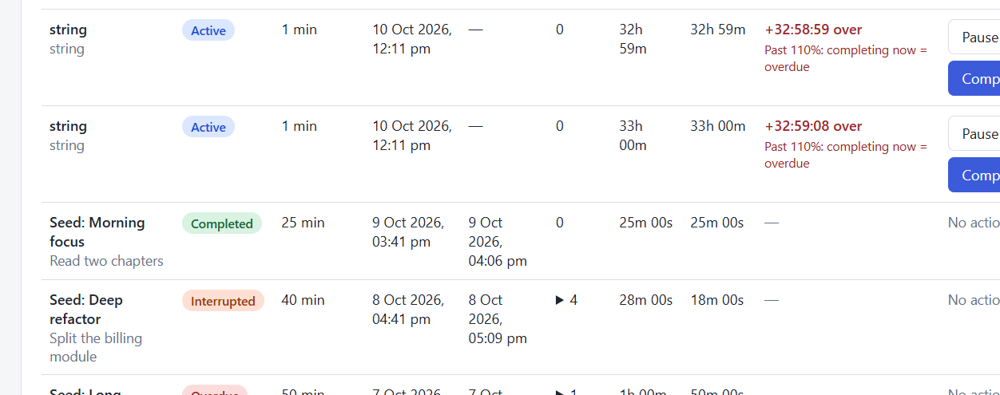
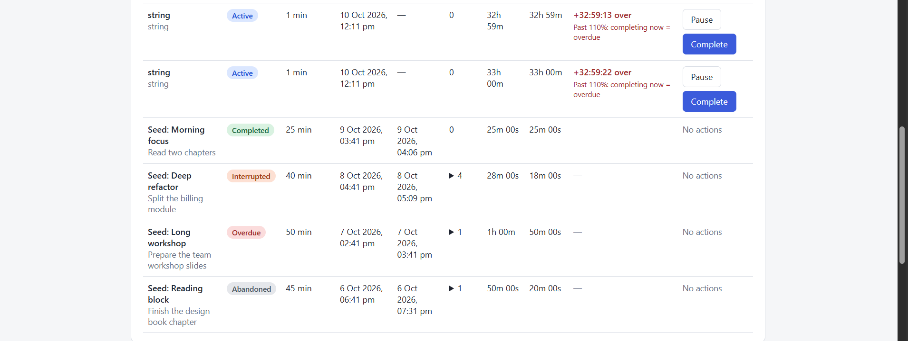
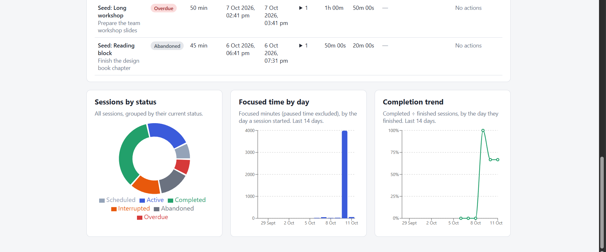
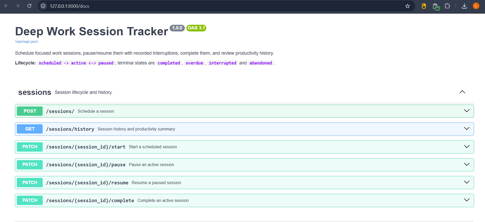
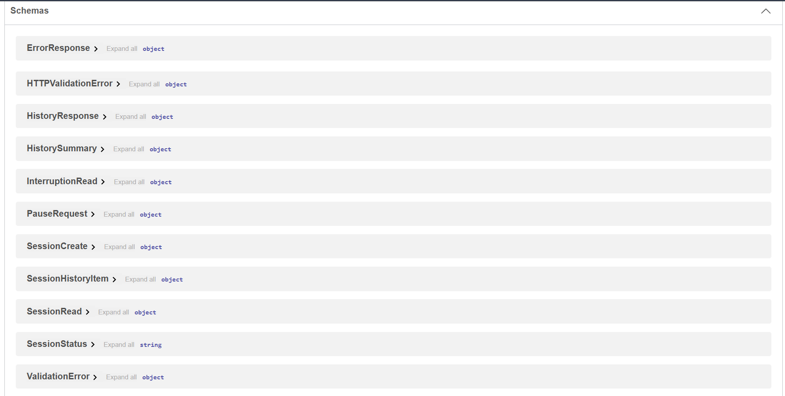

# Deep Work Session Tracker

A full-stack app for scheduling focused work sessions, pausing and resuming them with recorded interruptions, completing them, and reviewing productivity history. Built as the Aumne AI Python Developer Internship assessment.

## Features

- Six REST endpoints: schedule, start, pause, resume, complete, and history.
- Business rules enforced in a service layer: valid state transitions, a fourth-pause interruption rule, a 110% overdue rule, and automatic abandonment of unresumed pauses.
- SQLite persistence with Alembic migrations and SQL seed data.
- React dashboard: scheduling form, per-status controls, history table with live countdown, summary cards, and three charts.
- Python SDK generated from the project's own OpenAPI schema.
- Automated pytest suite on an isolated in-memory database.
- Windows scripts for setup, running, and SDK generation.

## Technology stack

| Area | Technology |
|---|---|
| Backend | Python 3.10+, FastAPI, Pydantic v2, SQLAlchemy 2.x |
| Database | SQLite, Alembic |
| Frontend | React 18, Vite, Axios, Recharts |
| SDK | OpenAPI Generator CLI (Python generator) |
| Tests | pytest, httpx (FastAPI TestClient) |

## Project structure

```text
deep-work-tracker/
├── backend/
│   ├── main.py                  # App wiring, CORS, error-to-HTTP mapping
│   ├── database.py              # Engine (foreign keys on), session factory, get_db dependency
│   ├── models.py                # ORM models, status enum, UTC datetime type
│   ├── schemas.py               # Pydantic request/response schemas
│   ├── routers/sessions.py      # HTTP layer only; no business rules
│   ├── services/
│   │   ├── exceptions.py        # Domain errors (404 / 409 / 500)
│   │   └── session_service.py   # All business rules and transactions
│   └── tests/                   # conftest, helpers, endpoint, rule and database tests
├── alembic/versions/            # 0001 (supplied schema), 0002 (additions)
├── frontend/                    # React app (src/components, hooks, services, utils)
├── deepwork_sdk/                # Generated Python SDK
├── seed_data.sql                # Sample sessions covering every status
├── sdk_smoke_test.py            # Exercises the generated SDK against the running API
├── requirements.txt
├── alembic.ini
├── pytest.ini
├── setupdev.bat
├── runapplication.bat
├── generate_sdk.bat
└── README.md
```

## Prerequisites

- Windows with `cmd` (the scripts are `.bat` files).
- Python 3.10 or newer (3.11+ recommended).
- Node.js 18 or newer, with npm.
- **For SDK generation only:** Java 11 or newer. Java 8 fails with `UnsupportedClassVersionError`. Check with `java -version` and `where java`.
- `curl`, which ships with Windows 10 and later.

No Docker is required.

## Quick start

From the project root:

```bat
setupdev.bat            REM creates env\, installs dependencies, applies migrations
setupdev.bat --seed     REM same, and also loads seed_data.sql into deepwork.db
runapplication.bat      REM migrates, then starts backend and frontend in two windows
```

Then open:

- App: http://localhost:5173
- Swagger UI: http://localhost:8000/docs
- OpenAPI schema: http://localhost:8000/openapi.json

Close the two service windows (or press Ctrl+C in them) to stop.

## Manual setup

```bat
python -m venv env
env\Scripts\activate
pip install -r requirements.txt
alembic upgrade head

cd frontend
npm install
cd ..
```

Run the backend from the project root (the package is `backend`):

```bat
env\Scripts\activate
uvicorn backend.main:app --reload
```

`python -m backend.main` also works and starts the same app on port 8000.

Run the frontend in a second terminal:

```bat
cd frontend
npm start
```

## Environment configuration

All variables are optional.

| Variable | Used by | Default | Purpose |
|---|---|---|---|
| `DATABASE_URL` | backend, Alembic | `sqlite:///<project>/deepwork.db` | SQLite database location (SQLite URLs only) |
| `ABANDONMENT_TIMEOUT_MINUTES` | backend | `30` | How long a pause may last before the session is abandoned |
| `CORS_ALLOWED_ORIGINS` | backend | `localhost`/`127.0.0.1` on ports 3000 and 5173 | Comma-separated browser origins |
| `VITE_API_BASE_URL` | frontend | `http://localhost:8000` | Backend address (see `frontend/.env.example`) |
| `DEEPWORK_API_URL` | `generate_sdk.bat`, `sdk_smoke_test.py` | `http://localhost:8000` | Backend address for the SDK steps |

`deepwork.db` and `.env` files are git-ignored.

## Database, migrations and seed data

Alembic owns the schema. The app never calls `create_all`.

- `0001_initial_schema` reproduces the supplied `sessions` and `interruptions` DDL exactly.
- `0002_interruption_resume_time` adds, as the brief requires for extra needs, a migration instead of editing the supplied schema:
  - `interruptions.resume_time` (nullable), used for paused-time accounting.
  - An index on `interruptions.session_id`.
  - A partial unique index allowing at most one unresumed pause per session. This blocks double-pause races at the database level.

```bat
alembic upgrade head
alembic current
```

Load the sample data (safe to run repeatedly; it replaces only rows titled `Seed: ...`):

```bat
python -c "import sqlite3; c=sqlite3.connect('deepwork.db'); c.executescript(open('seed_data.sql', encoding='utf-8').read()); c.close()"
```

The seed has eight sessions: scheduled, active, two completed, paused, interrupted, overdue, and abandoned. Timestamps are relative to the load time. The paused sample becomes `abandoned` about 25 minutes after loading, which is the abandonment rule working as designed.

## API

Base URL `http://localhost:8000`. Interactive docs at `/docs`.

| Method | Endpoint | Success | Description |
|---|---|---|---|
| POST | `/sessions/` | 201 | Schedule a session (`title`, `duration` minutes, optional `goal`) |
| PATCH | `/sessions/{session_id}/start` | 200 | `scheduled` to `active`; records `start_time` |
| PATCH | `/sessions/{session_id}/pause` | 200 | `active` to `paused`; body `{"reason": "..."}` is required |
| PATCH | `/sessions/{session_id}/resume` | 200 | `paused` to `active` |
| PATCH | `/sessions/{session_id}/complete` | 200 | `active` to `completed` or `overdue` |
| GET | `/sessions/history` | 200 | All sessions (newest first) plus a productivity summary |

Errors always use `{"detail": "..."}`:

| Status | Meaning |
|---|---|
| 404 | Session id does not exist |
| 409 | Action not allowed in the current state, including any action on a terminal session |
| 422 | Invalid input (blank title, `duration` outside 1 to 1440, empty pause reason, non-positive id) |
| 500 | Database or unexpected error (generic message, details only in server logs) |

History items include the pause count, interruption reasons, `elapsed_seconds`, `paused_seconds`, and `focused_seconds`. The summary includes total sessions, per-status counts, completion rate, total interruptions, total focused seconds, and the average focused time of completed sessions.

## Design decisions and business-rule interpretations

The brief leaves several rules open. These are the choices made.

**State machine.** `scheduled -> active <-> paused`. The terminal states are `completed`, `overdue`, `interrupted`, and `abandoned`. Every lifecycle action on a terminal session returns 409. Pause and complete are accepted only from `active`; resume only from `paused`; start only from `scheduled`.

**Interruption threshold.** More than three pauses means interrupted. Pauses one to three are allowed; the fourth pause sets `interrupted` immediately, with `end_time` equal to that pause time. The fourth pause is still recorded as an interruption row, left unresumed. The session never sits in `paused`, so abandonment cannot apply to it.

**Overdue threshold.** Completion is `overdue` when elapsed time is strictly greater than `scheduled duration x 110%`. Exactly 110% (55 minutes for a 50-minute session) is still `completed`. The check uses exact integer `timedelta` arithmetic, not floats.

**Paused time and overdue.** Elapsed time is wall-clock time from `start_time` to completion, so paused time counts toward the overdue limit. The UI shows an "Overdue in" figure that follows the same rule. Focused time (elapsed minus paused) is reported separately in history and analytics.

**Abandonment.** A pause left unresumed for 30 minutes (configurable) is finalized as `abandoned`.
- It is applied lazily, with no background worker: when the session is touched by any action, and when `GET /sessions/history` runs.
- The boundary is `now >= pause_time + timeout`. A resume at or after the deadline is rejected with 409.
- `end_time` is set to `pause_time + timeout`, not to the moment it was noticed, so results do not depend on when someone looks.

**Conflicting outcomes.** Interrupted takes precedence over overdue: overdue is evaluated only when completing from `active`.

**Completion rate.** `completed / sessions in a terminal state x 100`, and `0.0` when there are none. `overdue` is counted separately and does not count as completed. Active, paused, and scheduled sessions are excluded.

**Timestamps.** Stored as naive UTC in SQLite; the ORM returns timezone-aware UTC and rejects naive datetimes on write. The frontend displays them in the browser's local time.

**Race safety.** Every status change is a compare-and-swap `UPDATE ... WHERE id = ? AND status = ?`. If it matches no row, another request changed the session first and the API returns 409. Each pause runs in one transaction, and SQLite foreign keys are enabled on every connection.

**Input limits.** `duration` is limited to 1 to 1440 minutes (a safety cap I added). Titles are limited to 200 characters, goals to 1000, and pause reasons to 500. Surrounding whitespace is trimmed, and a blank goal is stored as null.

**Frontend.** The UI hides actions that do not fit the current status but never decides rules. After every action, success or failure, it re-fetches history, so a rejected action shows the server's message and the true state. History also refreshes every 15 seconds while the tab is visible, which is how lazy abandonment appears without a reload. The countdown starts from server-computed seconds and adds client time since the response arrived, so browser clock skew does not matter. The charts show the last 14 local days; older sessions still count in the summary cards and the status chart.

## Running tests

```bat
python -m pytest
python -m pytest -v
python -m pytest backend/tests/test_sessions.py -v
python -m pytest backend/tests/test_session_rules.py -v
python -m pytest backend/tests/test_database.py -v
python -m pytest -k "overdue or abandon or interrupt" -v
```

Tests run on an in-memory database and a controllable fake clock, so `deepwork.db` is never opened. They cover all six endpoints, normal lifecycles, every invalid transition, three versus four pauses, overdue boundaries (including exactly 110% and one second over), abandonment boundaries, missing and invalid ids, empty history, race guards, transaction rollback, Alembic migrations on a temporary file database, and the seed data.

## Python SDK

The SDK is generated from the running API's own schema, not written by hand. The package name is `deepwork_sdk`.

With the backend running:

```bat
generate_sdk.bat
```

The script installs the OpenAPI Generator CLI if missing (`npm install -g @openapitools/openapi-generator-cli`), regenerates `deepwork_sdk\`, installs it into the virtual environment in editable mode, and runs `sdk_smoke_test.py`. The smoke test drives a full lifecycle through the SDK, checks a 404 and a 409, and compares the SDK's history with a raw HTTP response. It creates one session titled "SDK smoke test" in the backend's database.

The equivalent manual command:

```bat
openapi-generator-cli generate -i http://localhost:8000/openapi.json -g python -o deepwork_sdk --additional-properties=packageName=deepwork_sdk,projectName=deepwork-sdk
env\Scripts\python -m pip install -e deepwork_sdk
```

Usage (generated defaults to port 80, so set the host explicitly):

```python
from deepwork_sdk import ApiClient, Configuration
from deepwork_sdk.api.sessions_api import SessionsApi
from deepwork_sdk.models import PauseRequest, SessionCreate

with ApiClient(Configuration(host="http://localhost:8000")) as client:
    api = SessionsApi(client)
    session = api.schedule_session(session_create=SessionCreate(title="Write report", duration=50))
    api.start_session(session_id=session.id)
    api.pause_session(session_id=session.id, pause_request=PauseRequest(reason="Coffee"))
    api.resume_session(session_id=session.id)
    print(api.complete_session(session_id=session.id).status)
    print(api.get_session_history().summary.completion_rate)
```

Method names come from explicit `operation_id`s: `schedule_session`, `start_session`, `pause_session`, `resume_session`, `complete_session`, `get_session_history`. If a generator version names things differently, check `deepwork_sdk\docs\SessionsApi.md`.

## Troubleshooting

- **`UnsupportedClassVersionError` during SDK generation:** Java is too old. Install Java 11 or newer and make sure it comes first on PATH (`where java`).
- **Frontend cannot reach the backend:** confirm the backend is on port 8000 and the frontend on 5173. The frontend port is fixed (`strictPort`) because the backend's default CORS list allows 3000 and 5173 only.
- **"Database is missing tables" warning at startup:** run `alembic upgrade head`.
- **Batch files misbehave:** `.bat` files must use CRLF line endings (`.gitattributes` enforces this).
- **`npm audit` warnings:** these concern dev tooling. Avoid `npm audit fix --force`, which can break the build.

## Screenshots






